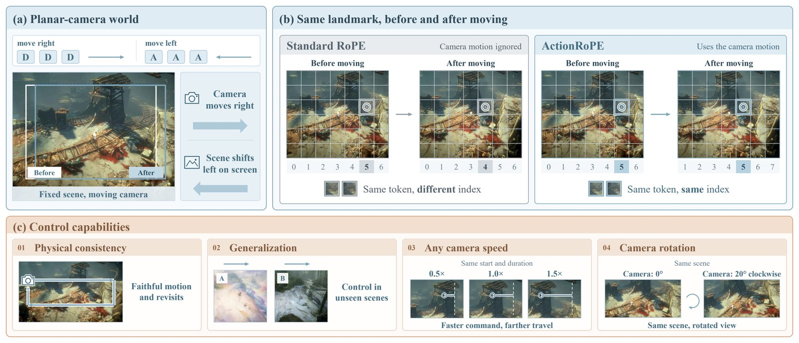
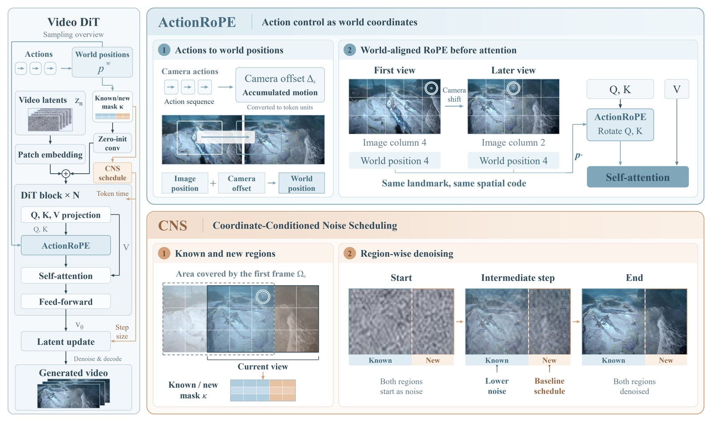

<div align="center">

# ActionRoPE: Action as Coordinates for Spatially Consistent Control in Planar-Camera Game World Models

Zhiyang Deng<sup>1,2,†</sup>, Yuzhe Wu<sup>1,2,†</sup>, Zijun Lin<sup>1,3,†</sup>, Yeying Jin<sup>1,2,‡,*</sup>

<sup>1</sup>Tencent, <sup>2</sup>National University of Singapore, <sup>3</sup>Nanyang Technological University

<sup>†</sup>Work done during research internships at Tencent · <sup>‡</sup>Project lead · <sup>*</sup>Corresponding author

[**Paper**](https://arxiv.org/abs/2610.25861) · [**Project page**](https://teawhite.cn/ActionRoPE/) · [**Checkpoints**](https://huggingface.co/teawhite/ActionRoPE)

</div>



In planar-camera worlds, such as top-down and isometric games, every player action moves the camera by a known
planar displacement. **ActionRoPE** writes this displacement directly into the rotary positions of the video tokens,
so that tokens at the same world location keep the same positional address over time. It needs no parameters on the
control path. The world coordinates also tell which regions the first frame already shows and which are newly
revealed. **Coordinate-Conditioned Noise Scheduling (CNS)** uses this split to give every token its own denoising
schedule: known regions settle earlier, and new content is generated with reference to them.

This repository contains training and inference code for the full method (ActionRoPE + CNS + the known/new input
channel) on four video backbones, together with the released checkpoints.



## Installation

```bash
git clone https://github.com/TeaWhiteBro/ActionRoPE.git && cd ActionRoPE
python3.12 -m venv .venv && source .venv/bin/activate
pip install torch==2.11.0 torchvision==0.26.0 --index-url https://download.pytorch.org/whl/cu128
pip install -r requirements.txt
```

All four backbones run on the same DiffSynth-Studio commit (pinned in `requirements.txt`). The results were produced
on H200 GPUs (141 GB) with Python 3.12, PyTorch 2.11 and CUDA 12.8.

## Checkpoints

All checkpoints are ActionRoPE + CNS with the known/new input channel, trained for 5,000 steps; they are the models
reported in the paper.

| Backbone | File in [teawhite/ActionRoPE](https://huggingface.co/teawhite/ActionRoPE) | Size | Format |
|---|---|---|---|
| Wan2.2-TI2V-5B | `wan2.2-ti2v-5b/actionrope_cns.safetensors` | 10.0 GB | full DiT |
| SkyReels-V2-DF-1.3B-540P | `skyreels-v2-df-1.3b/actionrope_cns.safetensors` | 2.9 GB | full DiT |
| LTX-2.5 (22B) | `ltx-2.5-22b/actionrope_cns.safetensors` | 38 GB | full DiT (LoRA merged) |
| MiniMax-H3 (33B) | `minimax-h3-33b/actionrope_cns_lora.safetensors` | 1.2 GB | LoRA + input channel |

```bash
huggingface-cli download teawhite/ActionRoPE --local-dir checkpoints                 # everything
huggingface-cli download teawhite/ActionRoPE --include "wan2.2-ti2v-5b/*" --local-dir checkpoints
```

Each checkpoint also needs the files of the base model it was fine-tuned from (VAE, text encoder, base DiT):

| Backbone | Base model | `--model_dir` |
|---|---|---|
| Wan2.2-TI2V-5B | [Wan-AI/Wan2.2-TI2V-5B](https://huggingface.co/Wan-AI/Wan2.2-TI2V-5B) | `models/Wan2.2-TI2V-5B` |
| SkyReels-V2-DF-1.3B | [Skywork/SkyReels-V2-DF-1.3B-540P](https://huggingface.co/Skywork/SkyReels-V2-DF-1.3B-540P) | `models/SkyReels-V2-DF-1.3B-540P` |
| LTX-2.5 | [Lightricks/LTX-2.5](https://huggingface.co/Lightricks/LTX-2.5) + [DiffSynth-Studio/LTX-2.5-Repackage](https://modelscope.cn/models/DiffSynth-Studio/LTX-2.5-Repackage) | `models/LTX-2.5` |
| MiniMax-H3 | [MiniMaxAI/MiniMax-H3](https://huggingface.co/MiniMaxAI/MiniMax-H3) (FL2VA) | `models/MiniMax-H3/FL2VA` |

```bash
huggingface-cli download Wan-AI/Wan2.2-TI2V-5B --local-dir models/Wan2.2-TI2V-5B
huggingface-cli download Skywork/SkyReels-V2-DF-1.3B-540P --local-dir models/SkyReels-V2-DF-1.3B-540P
```

```bash
# LTX-2.5 (gated on Hugging Face: accept the license on the model page first) + tokenizer / text post-modules (ModelScope)
huggingface-cli download Lightricks/LTX-2.5 --local-dir models/LTX-2.5 --include \
    "diffusion_models/ltx-2.5-22b-dev-transformer-bf16.safetensors" "text_encoders/gemma4-12b-with-proj-ltx-2.5-bf16.safetensors" \
    "vae/ltx-2.5-video-vae-bf16.safetensors" "vae/ltx-2.5-audio-vae-bf16.safetensors"
modelscope download --model DiffSynth-Studio/LTX-2.5-Repackage --local_dir models/LTX-2.5-Repackage
# MiniMax-H3: only the FL2VA (first frame + text to video) partition is needed
huggingface-cli download MiniMaxAI/MiniMax-H3 --include "FL2VA/*" --local-dir models/MiniMax-H3
```

The LTX-2.5-Repackage folder may sit next to `models/LTX-2.5` (found automatically) or be given with
`--set repack_dir=...`.

## Generate a clip

Give a first frame and an action sequence:

```bash
python scripts/sample.py --model wan \
    --ckpt checkpoints/wan2.2-ti2v-5b/actionrope_cns.safetensors --model_dir models/Wan2.2-TI2V-5B \
    --first_frame my_frame.png --actions "right:40,left:40" --out clip.mp4
```

- `--actions` lists `<direction>[*<speed>]:<frames>` segments for the 80 frames after the first one (16 fps). For
  example, `"right:40,left:40"` walks right for 2.5 s and back, and `"up-right*1.5:24,idle:16,left:40"` walks
  diagonally at 1.5× speed, stops, then walks left. The directions are `idle`, `up`, `down`, `left`, `right`, `up-left`,
  `up-right`, `down-left` and `down-right`. Speed 1.0 is the walking speed of the training data, 69.2 px/s
  horizontally and 46.0 px/s vertically.
- `--offsets offsets.json` gives the camera path directly, as 81 per-frame `[dx, dy]` offsets in pixels (x right, y
  down; the background moves by the negative offset).
- `--prompt` describes the scene only, e.g. `"In a 2.5D top down view, the player is in a dark cave lit by blue
  crystal glow."`. The default `"In a 2.5D top down view."` is what the paper's evaluation used. Actions never go into
  the text.
- Inputs that are not 832×480 are centre-cropped to that aspect ratio and resized, so the pixel scale of the scene is
  preserved.
- `--model skyreels | ltx | h3` selects the other backbones. Each samples with its paper settings by default.
  `--set key=value` passes backbone options, e.g. `--set fps_conditioning=true` for SkyReels-V2 (see the docstring of
  `actionrope/models/<model>.py`).
- MiniMax-H3 generates 73 frames (its video length is 17n + 5 frames): the 5 s camera path is compressed to them and
  the clip is written at 14.4 fps, so it still lasts 5 s.

| Backbone | Sampling (paper settings) | GPU memory | Time per clip (H200) |
|---|---|---|---|
| Wan2.2-TI2V-5B | 50 steps, no CFG | 18 GB | 15 s |
| SkyReels-V2-DF-1.3B | 50 steps, no CFG | 11 GB | 35 s |
| LTX-2.5 | 30 steps, CFG 3 | 70 GB | 105–120 s |
| MiniMax-H3 | 30 steps (CFG-distilled) | 75 GB (the 64 GB text encoder runs before the DiT) | 36 s + 23 s text encoding |

## Training

### Data format

The dataset is one JSON-lines annotation file with a row per 81-frame clip (832×480, 16 fps). See
[`actionrope/data.py`](actionrope/data.py):

```json
{"clip": "000123", "video": "clips/000123.mp4", "split": "train", "kind": "plain", "valid": true, "rt_ratio": 0.98,
 "sources": [], "frame_offset_px": [[0.0, 0.0], [4.3, 0.1], ...], "prompts": ["In a 2.5D top down view, the player is in ...", ...]}
```

- `frame_offset_px` holds the 81 per-frame camera offsets: the player's on-screen displacement from frame 0, from the
  game state.
- `prompts` holds 21 scene prompts, one per 4-frame latent frame. They change only inside scene-transition clips
  (`kind` = `burn` / `hardcut`, made from the two `sources` clips).
- Training skips clips with an invalid camera track, transition clips made from a validation clip, and plain clips
  recorded below 80 % of real time (`rt_ratio`).

Pre-compute latents (and, for Wan2.2, SkyReels-V2 and LTX-2.5, a table of prompt embeddings) for the backbone you
train:

```bash
python scripts/encode_latents.py --model wan --model_dir models/Wan2.2-TI2V-5B \
    --annotations data/annotations.jsonl --out_dir data/latents/wan --shard 0/8      # one process per GPU, shards 0..7
python scripts/build_text_table.py --model wan --model_dir models/Wan2.2-TI2V-5B \
    --annotations data/annotations.jsonl --out data/text_table_umt5.pt               # shared by wan and skyreels
```

### Fine-tuning

`configs/train/<model>.yaml` holds the recipe of each released checkpoint. Override paths or settings with
`--set key=value`:

```bash
accelerate launch --config_file configs/accelerate/zero2_ga2.yaml scripts/train.py --config configs/train/wan.yaml \
    --set annotations=data/annotations.jsonl latent_dir=data/latents/wan text_table=data/text_table_umt5.pt output=runs/wan
```

| Backbone | Config | Fine-tuning | Batch (GPUs x accumulation) | Memory per GPU | Time for 5,000 steps (8 H200) |
|---|---|---|---|---|---|
| Wan2.2-TI2V-5B | `wan.yaml` + `zero2_ga2.yaml` | full, lr 1e-5 | 16 (8 x 2) | 24 GB | 3.3 h |
| SkyReels-V2-DF-1.3B | `skyreels.yaml` + `zero2_ga2.yaml` | full, lr 1e-5 | 16 (8 x 2) | 16 GB | 18 h |
| LTX-2.5 | `ltx.yaml` + `zero2_ga2.yaml` | LoRA r128, lr 1e-4 | 16 (8 x 2) | 43 GB | 8.6 h |
| MiniMax-H3 | `h3.yaml` + `zero2_ga1.yaml` | LoRA r128, lr 1e-4 | 8 (8 x 1) | 78 GB | 5.5 h |

All recipes use AdamW (weight decay 0.01), a linear warm-up, gradient clipping at 1.0, bf16 and DeepSpeed ZeRO-2. To
run on fewer GPUs, keep the total batch by raising `grad_accum` and pick the accelerate config with the same
accumulation (or edit `num_processes` / `gradient_accumulation_steps` in it).

## Repository layout

```
actionrope/
  geometry.py      clip format, action strings -> per-frame camera offsets
  coords.py        known / newly revealed regions in world coordinates
  cns.py           Coordinate-Conditioned Noise Scheduling
  data.py          annotation file, training filters, text tables
  trainer.py       training loop shared by all backbones (Accelerate + DeepSpeed ZeRO-2)
  lora.py, media.py, prompts.py, checkpoint.py
  models/          wan.py, skyreels.py (+ wan_dit.py, umt5.py), ltx.py (+ ltx_dit.py), h3.py (+ h3_dit.py)
configs/           training recipes and accelerate configs
scripts/           sample.py, train.py, encode_latents.py, build_text_table.py
tests/             CPU tests (python -m pytest tests)
```

## Citation

```bibtex
@misc{deng2026actionropeactioncoordinatesspatially,
      title={ActionRoPE: action as coordinates for spatially consistent control in planar-camera game world models},
      author={Zhiyang Deng and Yuzhe Wu and Zijun Lin and Yeying Jin},
      year={2026},
      eprint={2610.25861},
      archivePrefix={arXiv},
      primaryClass={cs.CV},
      url={https://arxiv.org/abs/2610.25861},
}
```

## License and acknowledgements

The code is released under the [Apache-2.0 license](LICENSE). Each checkpoint is a derivative of its base model and
is subject to that model's license: Wan2.2 (Apache-2.0), SkyReels-V2 (Skywork license), LTX-2.5 (LTX-2.x Community
License Agreement) and MiniMax-H3 (MiniMax-H3 Community License Agreement). We build on
[DiffSynth-Studio](https://github.com/modelscope/DiffSynth-Studio) and thank the authors of Wan2.2, SkyReels-V2,
LTX-2.5 and MiniMax-H3 for releasing their models.
